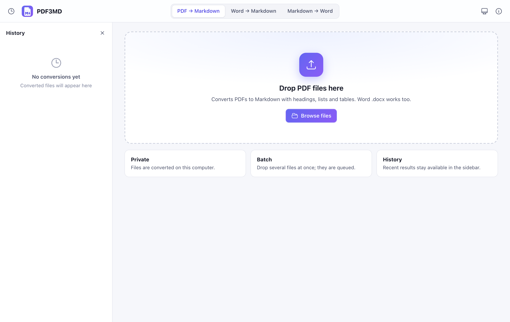
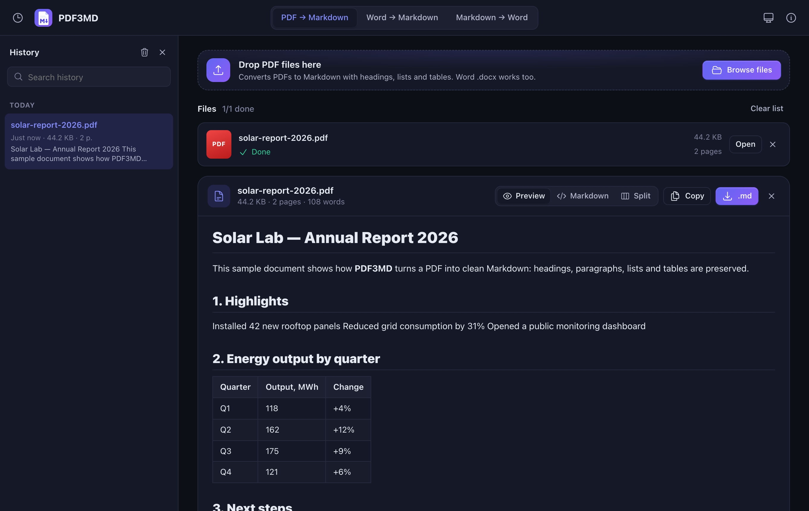

# PDF3MD - PDF to Markdown and Word Converter

[](https://www.gnu.org/licenses/agpl-3.0)
[](https://github.com/kureinmaxim/pdf3md/actions/workflows/build-backend-image.yml)
[](https://github.com/kureinmaxim/pdf3md/actions/workflows/build-frontend-image.yml)

> **Efficient conversion of PDF documents to Markdown and Microsoft Word formats**

PDF3MD is a powerful web application for converting PDF documents into well-structured Markdown and DOCX formats. Features a modern React frontend with Python Flask backend, providing real-time progress tracking and a seamless user experience.

## Port Matrix

| Mode | Frontend | Backend API |
|------|----------|-------------|
| Desktop app (macOS/Windows) | `http://localhost:6201` | `http://localhost:6201` |
| Docker (prod) | `http://localhost:3000` | `http://localhost:6201` |
| Manual dev | `http://localhost:5173` | `http://localhost:6201` |




---

## ✨ Features

- **📄 PDF to Markdown** - Transform PDFs into clean, readable Markdown while preserving document structure
- **📝 Markdown to Word** - Convert Markdown to professionally formatted DOCX files using Pandoc
- **🚀 Multi-File Upload** - Process multiple PDF files simultaneously
- **🎯 Drag & Drop Interface** - Intuitive file uploads via drag-and-drop or traditional selection
- **⚡ Real-time Progress** - Detailed status updates during conversion with page-by-page tracking
- **📊 File Information** - Display filename, size, page count, and conversion timestamp
- **📃 Word to Markdown** - Convert .docx documents to Markdown
- **💎 Modern UI** - Clean responsive interface: mode tabs, large drop zone, file cards with progress, Preview / Markdown / Split result view with copy and download
- **🌗 Dark Theme** - Follows the system theme automatically, or pick Light / Dark manually (remembered)
- **✍️ Live Markdown Editor** - Markdown → Word with live preview, formatting profiles and opening .md files
- **🎨 New App Icon** - Consistent icon for macOS (.icns), Windows (.ico) and the browser favicon
- **🖥️ Standalone Apps** - Native executables for macOS and Windows (no Python/Node required)

---

## 🚀 Quick Start

Choose the method that works best for you:

### 🎯 Option 1: Standalone Application (Easiest)

**Perfect for end users - no dependencies required!**

#### macOS
1. Download `PDF3MD.dmg` from releases or build it:
   ```bash
   ./macos/build_app.sh
   ./macos/build_dmg.sh
   ```
2. Open the DMG and drag `PDF3MD.app` to Applications
3. Double-click `PDF3MD.app` - browser opens automatically!

#### Windows
1. Download `PDF3MD.exe` from releases or build it:
   ```powershell
   .\windows\build_app.ps1
   ```
2. Double-click `PDF3MD.exe` - browser opens automatically!

> 💡 **What happens:** The app starts the backend server and serves the frontend from it, then opens your browser to `http://localhost:6201`

---

### 🐳 Option 2: Docker (Recommended for Servers)

**Prerequisites:** Docker and Docker Compose installed

#### Using Pre-built Images (Fastest)

1. Create `docker-compose.yml`:
   ```yaml
   services:
     backend:
       image: docker.io/learnedmachine/pdf3md-backend:latest 
       container_name: pdf3md-backend
       ports:
         - "6201:6201"
       environment:
         - PYTHONUNBUFFERED=1
         - FLASK_ENV=production
         - TZ=America/Chicago
       volumes:
         - ./pdf3md/temp:/app/temp
       restart: unless-stopped
       healthcheck:
         test: ["CMD", "curl", "-f", "http://localhost:6201/"]
         interval: 30s
         timeout: 10s
         retries: 3
         start_period: 40s

     frontend:
       image: docker.io/learnedmachine/pdf3md-frontend:latest 
       container_name: pdf3md-frontend
       ports:
         - "3000:3000"
       depends_on:
         - backend
       restart: unless-stopped
       healthcheck:
         test: ["CMD", "wget", "--no-verbose", "--tries=1", "--spider", "http://localhost:3000/"]
         interval: 30s
         timeout: 10s
         retries: 3
         start_period: 40s

   networks:
     default:
       name: pdf3md-network
   ```

2. Start the application:
   ```bash
   docker compose up -d
   ```

3. Open in browser:
   - Frontend (Docker): `http://localhost:3000`
   - Backend API: `http://localhost:6201`

#### Using Helper Script

Download [`docker-start.sh`](docker-start.sh) and run:

```bash
chmod +x docker-start.sh
./docker-start.sh start              # Start production
./docker-start.sh start example.com  # Start with custom domain
./docker-start.sh dev                # Start development mode
./docker-start.sh stop               # Stop all services
./docker-start.sh logs               # View logs
./docker-start.sh help               # See all commands
```

---

### 💻 Option 3: Manual Setup (For Development)

**Prerequisites:** Python 3.13+, Node.js 20.19+ (or 22.12+, required by Vite 7), Pandoc, Git

1. **Clone repository:**
   ```bash
   git clone https://github.com/kureinmaxim/pdf3md.git
   cd pdf3md
   ```

2. **Backend (Terminal 1):**
   ```bash
   python3 -m venv .venv
   source .venv/bin/activate  # Windows: .venv\Scripts\activate
   pip install -r pdf3md/requirements.txt
   python run_server.py
   ```

3. **Frontend (Terminal 2):**
   ```bash
   cd pdf3md
   npm install
   npm run dev    # Development with hot-reload
   # OR
   npm run build  # Production build
   ```

4. **Open browser:**
   - Dev mode (Vite): `http://localhost:5173`
   - Production build served by backend: `http://localhost:6201`

---

## 📖 Usage Guide

### PDF to Markdown Conversion

1. Open the application in your browser and choose **PDF → Markdown** (or **Word → Markdown**)
2. Drop files anywhere on the page, or click the drop zone / press Enter on it to browse
3. Watch per-file progress with page indicators; several files are queued
4. Switch between **Preview**, **Markdown** and **Split** views
5. **Copy** the Markdown or **download** it as a `.md` file; earlier results stay in the History sidebar

### Markdown to Word Conversion

1. Switch to the **Markdown → Word** tab
2. Type or paste Markdown, or open / drop a `.md` file; the preview updates live
3. Pick a formatting profile (manage profiles with the sliders button)
4. Click **Download Word** to get the `.docx` file

---

## 🏗️ Building from Source

### macOS App Bundle

```bash
# Build .app
./macos/build_app.sh

# Create DMG installer
./macos/build_dmg.sh

# Output: dist/PDF3MD.dmg
```

**What gets bundled:**
- Python Flask backend (single executable)
- React frontend (built static files)
- Pandoc binary (if available)
- Auto-launch browser functionality

### Windows Executable

```powershell
# Build standalone .exe
.\windows\build_app.ps1

# Output: dist\windows\PDF3MD.exe
```

**What gets bundled:**
- Python Flask backend (single executable with PyInstaller)
- React frontend (built static files)
- Pandoc binary (if available)
- Auto-launch browser functionality

---

### App Icons

All icons are generated from the master SVGs in `assets/icon/`:

```bash
scripts/build_icons.sh   # needs Google Chrome (headless) and, on macOS, iconutil
```

This writes `macos/PDF3MD.icns`, `windows/PDF3MD.ico` and the web favicons in `pdf3md/public/`.

---

## ⚙️ Configuration

### Environment Variables

| Variable | Default | Description |
|----------|---------|-------------|
| `FLASK_ENV` | `production` | Flask environment mode |
| `FLASK_DEBUG` | `0` | Enable Flask debug mode |
| `PDF3MD_STATIC_DIR` | `pdf3md/dist` | Frontend static files directory |
| `PDF3MD_KILL_PORT` | `1` | Auto-kill processes on port 6201 |
| `ALLOWED_CORS_ORIGINS` | `*` | Comma-separated CORS origins |
| `TZ` | System default | Timezone for Docker containers |

### Ports

- **Desktop app (macOS/Windows):** `http://localhost:6201` (backend serves frontend)
- **Docker prod:** Frontend `http://localhost:3000`, Backend API `http://localhost:6201`
- **Development (manual):** Frontend `http://localhost:5173`, Backend API `http://localhost:6201`

### Network Access

- **Localhost:** Docker frontend `http://localhost:3000`, desktop/prod backend UI `http://localhost:6201`
- **LAN (Docker):** Access from other devices at `http://<host-ip>:3000`
  - Ensure firewall allows port 6201 for backend API
  - Frontend automatically connects to backend on same host

---

## 🔧 Reverse Proxy Setup

For production deployments behind Nginx, Apache, or Caddy:

### Nginx Example

```nginx
server {
    listen 80;
    server_name pdf3md.example.com;

    # Frontend
    location / {
        proxy_pass http://localhost:3000;
        proxy_set_header Host $host;
        proxy_set_header X-Real-IP $remote_addr;
        proxy_set_header X-Forwarded-For $proxy_add_x_forwarded_for;
        proxy_set_header X-Forwarded-Proto $scheme;
    }

    # Backend API
    location /api/ {
        proxy_pass http://localhost:6201/;
        proxy_set_header Host $host;
        proxy_set_header X-Real-IP $remote_addr;
        proxy_set_header X-Forwarded-For $proxy_add_x_forwarded_for;
        proxy_set_header X-Forwarded-Proto $scheme;
    }
}
```

**Key Points:**
- Frontend serves from domain root
- Backend API proxied at `/api/*`
- SSL/TLS termination recommended
- CORS pre-configured for same-origin

---

## 🛠️ Technology Stack

### Backend
- **Python 3.13+** - Core runtime
- **Flask 3.0** - Web framework
- **PyMuPDF4LLM** - PDF processing engine
- **Pandoc** - Markdown to DOCX conversion
- **python-docx** - DOCX formatting and manipulation

### Frontend
- **React 19** - UI framework
- **Vite 7** - Build tool and dev server
- **Plain CSS with design tokens** - light/dark themes via CSS variables, no UI framework
- **marked + DOMPurify** - Markdown preview with sanitized HTML

### Build Tools
- **PyInstaller** - Python executable bundler
- **npm** - Node package manager
- **Docker** - Containerization

---

## 📋 Project Structure

```
pdf3md/
├── pdf3md/                    # Main application directory
│   ├── __init__.py           # Package initialization
│   ├── app.py                # Flask routes (refactored)
│   ├── config.py             # Configuration module
│   ├── converters/           # PDF & DOCX conversion
│   ├── formatters/           # Document formatting
│   ├── utils/                # Utility functions
│   ├── src/                  # React frontend source
│   ├── dist/                 # Built frontend (production)
│   └── requirements.txt      # Python dependencies
├── pdf3md_standalone.py      # Standalone app entry point
├── run_server.py             # Development server runner
├── assets/icon/              # Master icon SVGs (pdf3md.svg, favicon.svg)
├── scripts/                  # build_icons.sh, update_version.py, build_meta.py
├── macos/                    # macOS build scripts
│   ├── build_app.sh         # Build .app bundle
│   ├── build_dmg.sh         # Create DMG installer
│   └── launcher.sh          # App launcher script
├── windows/                  # Windows build scripts
│   ├── build_app.ps1        # Build .exe
│   └── installer.iss        # Inno Setup config
├── docker-compose.yml        # Production Docker setup
├── docker-compose.dev.yml    # Development Docker setup
└── docker-start.sh          # Docker helper script
```

---

## 🐛 Troubleshooting

### Port Conflicts
```bash
# Check what's using port 6201
lsof -ti :6201  # macOS/Linux
netstat -ano | findstr :6201  # Windows

# Stop PDF3MD containers
docker compose down
```

### Docker Issues
```bash
# Rebuild from scratch
docker compose down
docker compose up --build -d

# View logs
docker compose logs -f

# Check container status
docker compose ps
```

### Build Issues

**macOS:**
```bash
# Ensure Pandoc is installed
brew install pandoc

# Clean build
rm -rf dist/
./macos/build_app.sh
```

**Windows:**
```powershell
# Ensure Pandoc is installed
choco install pandoc

# Clean build
Remove-Item -Recurse dist/
.\windows\build_app.ps1
```

### API Connectivity

1. Verify backend is running: `curl http://localhost:6201/version`
2. Check browser console for errors
3. Ensure firewall allows port 6201
4. Check CORS settings if accessing from different origin

---

## 📄 License

This project is **dual-licensed**:

### 1. GNU Affero General Public License v3.0 (AGPLv3)

[](https://www.gnu.org/licenses/agpl-3.0)

PDF3MD is offered under the AGPLv3 for open-source use. Key requirements:

- ✅ Free to use, modify, and distribute
- ✅ Must share source code modifications
- ⚠️ **Network use = distribution:** If you run PDF3MD on a server and let others access it, you must provide your source code

See [LICENSE](LICENSE) for full terms.

### 2. Commercial License

For organizations that cannot comply with AGPLv3 (e.g., proprietary integrations without source sharing), a commercial license is available.

**Contact maintainers** for commercial licensing options.

---

## 🙏 Acknowledgments

- [PyMuPDF4LLM](https://pypi.org/project/pymupdf4llm/) - PDF processing
- [Pandoc](https://pandoc.org/) - Document conversion
- [React](https://reactjs.org/) - Frontend framework
- [Flask](https://flask.palletsprojects.com/) - Backend framework
- [Vite](https://vitejs.dev/) - Build tool

---

## 🤝 Contributing

**Feedback and bug reports welcome!** Please open an issue on GitHub.

> **Note on Contributions:** If this project begins accepting code contributions, a Contributor License Agreement (CLA) will be required to ensure dual-licensing compatibility. Details will be provided when accepting external contributions.

---

## 📞 Support

- **Documentation:** See [INSTALLATION.md](INSTALLATION.md) and [VERSION_MANAGEMENT.md](VERSION_MANAGEMENT.md)
- **Issues:** [GitHub Issues](https://github.com/kureinmaxim/pdf3md/issues)
- **Docker Logs:** `./docker-start.sh logs`
- **Build Logs:** Check `dist/pyinstaller/build/pdf3md-server/warn-pdf3md-server.txt`

---

**Happy converting! 🎉**
